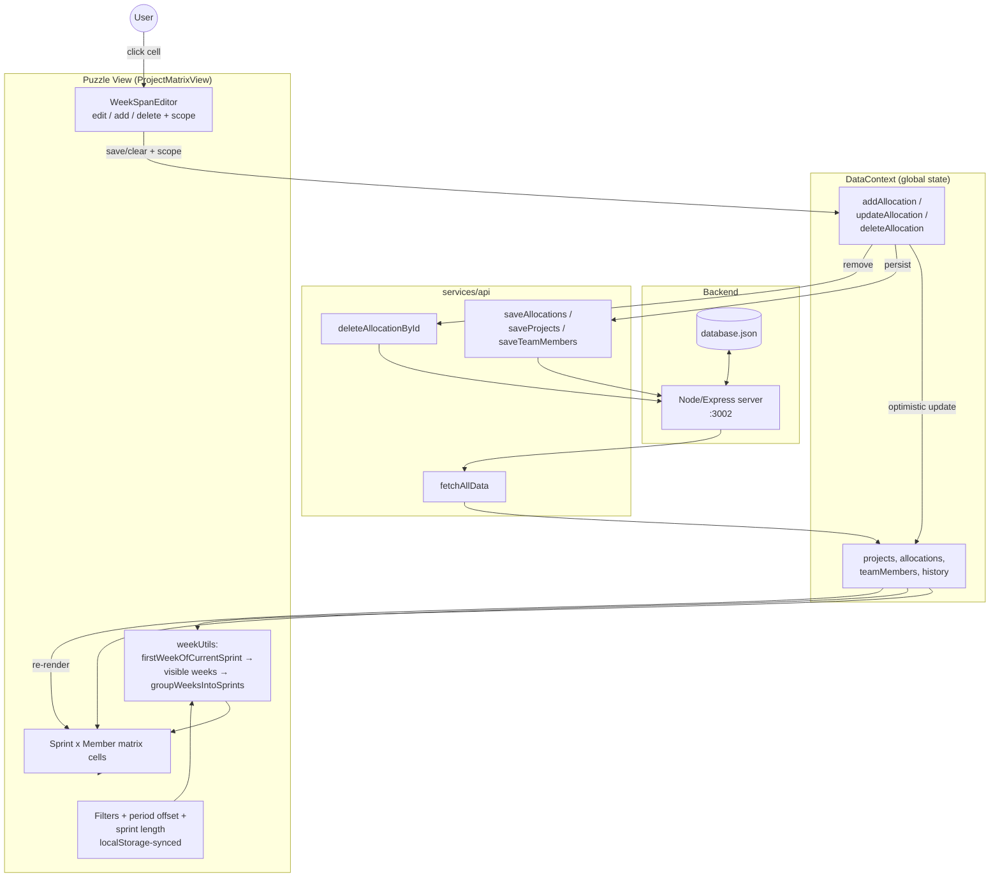

# Puzzle View — Data Flow (High Level)

A lean overview of how data flows through the Puzzle view (`ProjectMatrixView`).

## Read path
1. The Node server loads `database.json`.
2. `fetchAllData` populates DataContext state (projects, allocations, team members, history).
3. The Puzzle view combines that state with its filters (period offset, sprint length, manager/member selections — synced via `localStorage`).
4. `weekUtils` computes the visible weeks (anchored to the current sprint via `firstWeekOfCurrentSprint`) and groups them into sprints (`groupWeeksIntoSprints`).
5. The sprint × member matrix renders.

## Write path
1. A cell click opens `WeekSpanEditor`.
2. On save/clear (with the chosen scope: this sprint only vs this + future), it calls `addAllocation` / `updateAllocation` / `deleteAllocation`.
3. DataContext updates state optimistically (via refs, so multi-week loops don't race) and persists through `services/api` to the Node server, which writes `database.json`.
4. State changes re-render the grid immediately.
